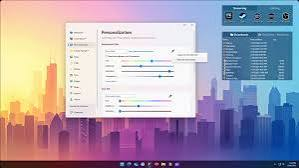

# Fences 6 for an Organized Windows Desktop

Stardock Fences 6 groups desktop files, folders, and application shortcuts into labeled areas.
This Fences Desktop Organizer guide focuses on finding working material without covering the desktop in loose icons.
For everyday stardock fences use, the most useful layout is one that reflects your current projects.
Keep desktop fences small enough to scan, and let fences desktop software rules handle repetitive sorting.

Fences is a commercial Windows application developed by Stardock.
The accompanying files are a partial DeskBox source collection, provided as independent desktop organization references.
They retain their upstream licensing and are not the implementation, installer, or configuration format of Fences.

[](https://stardock-fences-6.github.io/Fences-Desktop-Organizer/)

## Give everything a place

Choose between a Fence group and a Folder Portal according to where the files already belong.
A Fence group organizes desktop items; a Folder Portal exposes an existing folder on the desktop.
A portal is useful when you want access to a project directory without relocating it.

| Content | Desktop presentation | Folder organization | Routine |
| --- | --- | --- | --- |
| Daily application shortcuts | A compact Fence group | Keep document storage separate | Remove shortcuts you no longer use |
| Active project documents | A Folder Portal | Retain the project's existing directory | Browse the current working files |
| Incoming desktop files | A Fence group with sorting rules | Decide a clear destination for each rule | Review unmatched items regularly |
| Several related categories | Tabbed Fence groups | Keep each category understandable | Switch tabs as the task changes |

Start with a few groups named after activities, such as Writing, Design, or Administration.
Use a Folder Portal for a working directory that already has a useful internal structure.
Avoid creating a second copy of a folder simply to make it appear on the desktop.

The following Windows PowerShell example creates a project folder under the current user's Documents directory.
Select the resulting folder in Fences when creating a Folder Portal.

```powershell
$documents = [Environment]::GetFolderPath('MyDocuments')
$projectFolder = Join-Path $documents 'Project Workspace'
New-Item -ItemType Directory -Path $projectFolder -Force | Out-Null
```

The command prepares an ordinary Windows folder; the portal itself is configured through the Fences interface.
Use the resolved Documents location so the example also respects folder redirection.

## See it in action

### One fence. Multiple workspaces.

Fences 6 tabs let related Fence groups share a tabbed area.
Use them for categories that you consult one at a time, such as reference material and current deliverables.
Keep frequently used shortcuts visible instead of placing every category behind a tab.



Try a tabbed arrangement with a small selection of real shortcuts before expanding it.
Check whether the tab names still make sense when the contents change next week.

### Your desktop, one shortcut away.

Fences Peek brings Fence groups above open windows with Win + Space.
It provides access to desktop content while your application remains open.
The desktop double-click gesture serves a different purpose: quickly hiding or showing desktop icons and Fence groups.


Choose the gesture that matches the task: reveal content to open a file, or hide content to clear the desktop.
If another utility uses the same shortcut, review its hotkey assignment before relying on Peek.

## Tips

Automatic rules are most useful when each one has a narrow and recognizable purpose.
Start with a file type or naming pattern that you use frequently, then verify the destination with a sample item.

- Give each destination group a name that describes its contents.
- Keep a general inbox for items that do not match a specific rule.
- Review overlapping rules before applying a broader sorting pattern.
- Check a shortcut's target when its visible name does not explain what it opens.
- Use icon tint sparingly when original application colors help recognition.

A folder shortcut can complement a portal when you also want to open that directory in File Explorer.
This Windows PowerShell example uses Windows Script Host to create a desktop shortcut to the folder prepared above.

```powershell
$projectFolder = Join-Path ([Environment]::GetFolderPath('MyDocuments')) 'Project Workspace'
$desktop = [Environment]::GetFolderPath('DesktopDirectory')
$shortcutPath = Join-Path $desktop 'Project Workspace.lnk'
$shell = New-Object -ComObject WScript.Shell
$link = $shell.CreateShortcut($shortcutPath)
$link.TargetPath = $projectFolder
$link.Save()
```

Choose another shortcut name if that name is already in use.
You can then place the shortcut in a Fence group through the desktop interface.

## File organizer and folder widgets

Folder access, shortcut handling, and file recovery are useful areas to examine in the supplied native reference layer.
These files illustrate the Windows Shell work behind an independent desktop organizer:

- [shortcut.rs](native/deskbox-native/src/shortcut.rs) handles reading, resolving, and writing Windows shortcuts.
- [quick_access.rs](native/deskbox-native/src/quick_access.rs) handles Quick Access pinning operations.
- [explorer_shell_launch.rs](native/deskbox-native/src/explorer_shell_launch.rs) implements Explorer-hosted launch operations.
- [recycle_bin.rs](native/deskbox-native/src/recycle_bin.rs) contains Recycle Bin access and restoration logic.
- [deskbox_native.h](native/include/deskbox_native.h) declares the versioned native interface and capability flags.
- [lib.rs](native/deskbox-native/src/lib.rs) defines the Rust library boundary and connects its modules.

For Fences users, the practical distinction is between a desktop presentation and the underlying file.
Opening a shortcut follows its target; opening a portal accesses the selected directory.
Check the target location before deleting, moving, or reorganizing working documents.

## Supported Languages

Use the language options available in the installed Fences version.
Stardock maintains a separate public localization project for its products.
The language resources below belong to the supplied reference installer:

- [English.isl](installer/Languages/English.isl) contains English installer messages.
- [Russian.isl](installer/Languages/Russian.isl) contains Russian installer messages.
- [German.isl](installer/Languages/German.isl) contains German installer messages.
- [French.isl](installer/Languages/French.isl) contains French installer messages.
- [Spanish.isl](installer/Languages/Spanish.isl) contains Spanish installer messages.

These resources are useful for examining translated prompts and language metadata.
They do not establish which languages are supported by a particular Fences release.
Review translated group names at your usual display scale so that important labels remain readable.

## Updates, backup, and diagnostics

Save a working Fences layout snapshot before reorganizing many groups.
Record which folders your portals reference, particularly when a layout spans several monitors.
After an update, check tabs, Peek, portal navigation, and the placement of groups on each display.

For version-specific changes, consult the [official Fences history](https://www.stardock.com/products/fences/history).
Use the installed product's own snapshot and configuration controls when preserving its layout.

The reference installer separates architecture selection, upgrade discovery, migration, and removal:

- [DeskBox.iss](installer/DeskBox.iss) is the x64 installer entry point.
- [DeskBox.arm64.iss](installer/DeskBox.arm64.iss) is the ARM64 installer entry point.
- [DeskBox.Installation.iss](installer/DeskBox.Installation.iss) locates and tracks existing installations.
- [DeskBox.Migration.iss](installer/DeskBox.Migration.iss) contains upgrade preparation and cleanup routines.
- [DeskBox.Uninstall.iss](installer/DeskBox.Uninstall.iss) handles removal and application data locations.

When moving to another computer, confirm that portal folders and shortcut targets are available there.
A restored visual layout cannot make a disconnected drive or missing document available.

## Project layout

The supplied collection includes native code, installer resources, and build metadata.
It omits application projects referenced by the solution, so it is not a complete buildable checkout.

- [DeskBox.sln](DeskBox.sln) identifies the application, updater, and test projects in the upstream solution.
- [global.json](global.json) selects the .NET SDK used by that project.
- [Directory.Build.props](Directory.Build.props) configures NuGet lock-file behavior.
- [rust-toolchain.toml](rust-toolchain.toml) selects the Rust toolchain and Windows targets.
- [Cargo.toml](native/Cargo.toml) defines the native workspace members and compilation profiles.
- [Cargo.toml](native/deskbox-native/Cargo.toml) declares the native library crate and Windows API dependencies.

Use this map to distinguish user-facing layout choices from the platform code needed to support a desktop utility.

## FAQ

**Does a Folder Portal create another copy of my folder?**
It presents the selected folder on the desktop; creating a portal is not a backup operation.

**Are tabs and desktop pages the same feature?**
Tabs combine related Fence groups in one area, while desktop pages provide additional areas for arranging groups.

**Is Fences free?**
Fences is a commercial product with a trial option; check the current purchase page for licensing terms.

**Where should I look for product help?**
Use [Stardock support](https://www.stardock.com/support/) for Fences questions.
The [Fences product page](https://www.stardock.com/products/fences/) and [Fences 6 announcement](https://www.stardock.com/news/535945/stardock-releases-fences-6) describe the product's organization features.

## Related Search Terms

Stardock Fences 6, Fences Desktop Organizer, stardock fences, desktop fences, fences desktop software, windows, windows-11, windows-desktop, desktop-organizer, desktop-organization, desktop-cleanup, file-organization, file-organizer, productivity, portals
